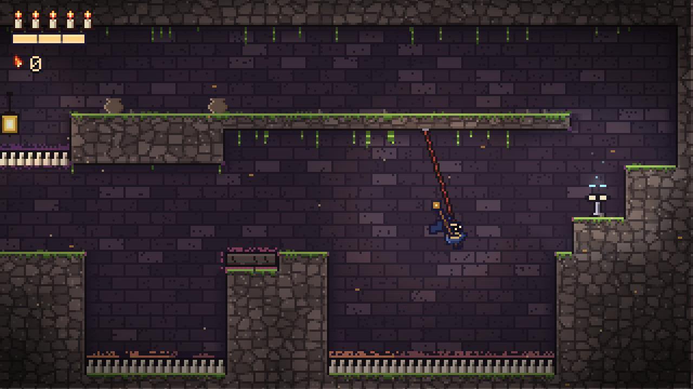
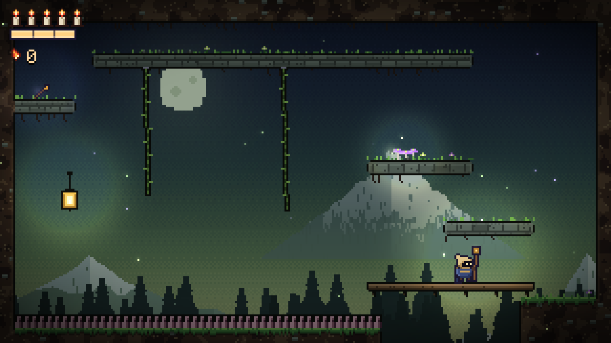
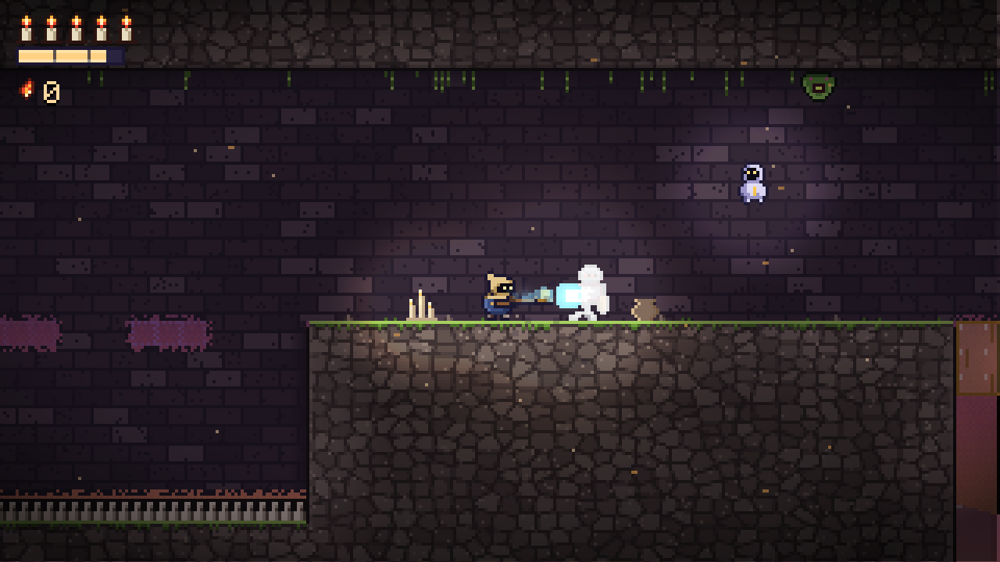
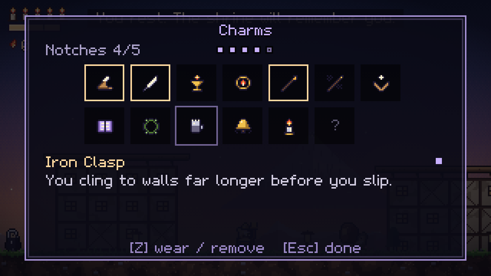
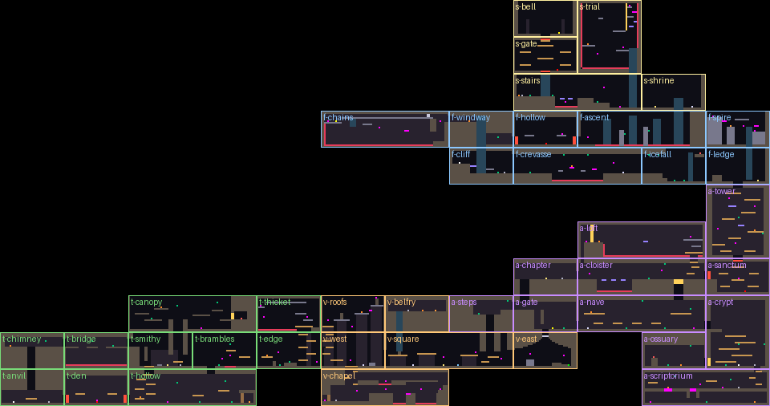

# HOLY PEAK

*A pilgrimage up the silent mountain.*

They say a bell hangs at the top of the Holy Peak, silent for a thousand years, and that while it sleeps, so does the dawn.
You have walked a long way to wake it.

**Holy Peak** is a hand-drawn-in-code action platformer set on one interconnected mountain.
Explore five regions, run and swing and vault through them, fight what lives there with your pilgrim's staff and the psalms you learn, wear charms that change how you play, and face four guardians that will not let you pass easily.


| | |
|---|---|
|  |  |
|  |  |
|  |  |
|  |  |
|  |  |

## The mountain

The world is one map of 41 chambers. Every region opens with something you find in the one before it, and old places hide new secrets once you can reach them.

| Region | | What you find there |
|---|---|---|
| **Pilgrim's Rest** | the village at the foot | a shrine, Old Tam the peddler, Sister Ione, a wayside chapel under the old well, and the rooftops above the watchtower |
| **Thornwood** | where the forest closed its hand | creatures, bramble beds, the old smithy, a trial of vines in the canopy and **Thornback**, the bramble boar |
| **The Sunken Abbey** | its prayers long since fallen silent | sentinels and choristers, bell-glass, the ringing loft, the scriptorium and **the Hollow Abbot** |
| **Frostwind Cliffs** | the wind never rests | icefalls, a crevasse, a trial of chains, the spire of the psalm and **the Frost Wyrm** |
| **The Holy Peak** | where the old bell waits | the stairs of light, the last trial and **the Bellkeeper** |

### Moving

Everything below is yours from the first step, and the mountain is built around it.

- **Ledge vault.** Press toward a ledge your hands can reach and you pull yourself up onto it.
- **Staff vault.** While running, hold Down and strike to plant your staff and spring forward in a long, low leap.
- **Ropes, vines and chains.** Jump at one and it catches you. Push left and right to swing higher, climb with Up and Down, and jump to let go with all the speed of the swing.
- **Lanterns.** Strike a hanging lantern and it throws you away from it; strike it from above to bounce high. It relights a moment later.
- **Crumbling ledges** shake when you stand on them, fall away, and reform a little later.
- **The staff** strikes sideways, upward, or downward in the air. A downward strike bounces you off creatures, upward thorns and projectiles.

Three relics open the way up the mountain:

- **The Iron Grips.** Cling to a wall where you catch it, then leap away. Leap between two walls to climb. Bell-glass is too slick to hold.
- **The Bell of Resonance.** Ring it to shatter bell-glass, wake resonance stones into platforms for a few seconds, stagger creatures and answer the rings that choristers sing. Rung in the air, it lifts you once more.
- **The Pilgrim's Kite.** Open it in the air to glide, and ride updrafts high into the cliffs.

### Grace and psalms

Every blow your staff lands gathers **grace**, shown as the bar of light under your flames.
Kneel and hold Heal to turn a third of it into a flame of vigil, or spend the same grace on a psalm. A psalm hits for half as much as your staff, but at range or over an area, so every spell is a heal you chose not to take.

- **Lantern Bolt** (the wayside chapel): a flame thrown forward that burns through every creature in its path.
- **Falling Star** (the scriptorium): hold Down and cast to plunge, break heavy slabs, and burst on landing.
- **Rising Psalm** (the frost spire): hold Up and cast to raise a pillar of light above you.

### Charms

Thirteen charms are hidden on the mountain, sold by Old Tam, guarded by trials or left behind by the guardians.
Wear them when you rest at a shrine, as many as your notches allow. You start with three notches and can find four more.
Some are about fighting (Long Staff, Quick Staff, Psalter, Bramble Vow), some about moving (Pilgrim's Stride, Feather Mantle, Iron Clasp, Echoing Bell), and some about staying alive (Votive Cup, Steady Prayer, Candle of Vigil, Thornward, Ember Charm).

### Trials

Four trials test everything you have learned: the vines of Thornwood, the ringing loft, the chains of the frost crevasse and the last trial below the summit.
In a trial, thorns send you back to the start of the trial. Each ends in a charm or a charm notch.

### Surviving

You have a row of vigil flames for health. Thorns cost a flame and put you back on safe ground.
If your last flame goes out you wake at the last shrine you rested at, and the embers you carried stay behind as a lingering flame. Go back and touch it to take them back. Die before you get there, and they are gone.

Embers drop from creatures and cracked ember caches. Old Tam sells a map of the mountain, charms, charm notches, whetstones, a grace vessel and a vessel of vigil.

## Controls

Every action can be rebound, on the keyboard (two keys each) and the gamepad, under Options > Controls.

| Action | Keyboard | Alternate | Gamepad |
|---|---|---|---|
| Move, look | Arrow keys | WASD | Left stick or D-pad |
| Jump, open the kite | Z | Space | A |
| Strike | X | J | X |
| Ring the bell | C | K | Y |
| Cast a psalm | F | I | RB or RT |
| Heal (hold) | V | L | B, LB or LT |
| Rest, talk, use | Up | W | Up |
| Map | Tab | M | Back |
| Pause | Esc | P | Start |
| Fullscreen | F11 | | |

Hold Down and strike in the air to bounce. Hold Down and strike while running to vault. Hold Down and jump on a thin ledge to drop through it.
Hold Up or Down while standing still to look around. Button prompts follow the keys you actually use.

## Features

- One connected world with fast transitions between chambers, a map that fills in as you explore and marks unread psalms and untaken charms, five shrines, and shortcuts that loop back to them.
- Eight kinds of creatures, each with a tell before it attacks, and four guardians with telegraphed patterns, a second phase when wounded, and arena doors that close behind you.
- A lighting pass: caves, crypts and the abbey are dark, and the lantern at the head of your staff, hanging lanterns, candles, lit windows and glowing creatures push the dark back.
- Everything is generated in code. There is no asset folder. The pixel font, every sprite, the terrain, the parallax mountains, the lighting, every sound effect and all eight pieces of music are made at startup.
- An original soundtrack that shares one theme across the village, each region, the guardians and the ending.
- Sister Ione, Elder Bram and Old Tam, lore tablets, an ending with statistics and how much of the mountain you found.
- Progress saves at shrines and when you collect something. Options cover volume, fullscreen, window size, screen shake, a speedrun timer, controls, and assists for game speed and invincibility.
- The mountain is proven passable. A solver searches the real game physics for every route the design depends on, and a whole-game walk plays from the village to the great bell.

## Download

Ready-to-play builds for Windows, macOS (Apple Silicon and Intel) and Linux are on the [Releases page](../../releases).
Nothing needs installing: unzip and play. Each download includes a `README.txt` with first-launch notes for unsigned apps.

## Running from source

You need the [.NET 8 SDK](https://dotnet.microsoft.com/download).

```sh
dotnet run --project src/HolyPeak -c Release
```

On the first launch the soundtrack renders in the background, which takes a few seconds, and is then cached.
Saves and settings live in a `HolyPeak` folder inside your user application-data folder (for example `%APPDATA%\HolyPeak` on Windows or `~/.config/HolyPeak` on Linux).
Set `HOLYPEAK_DATA` to use a different folder. Saves from version 2.0 carry over into 2.1; saves from version 1 do not.

### Building release packages

```sh
build/package.sh 2.1.0                      # all platforms, written to dist/
build/package.sh 2.1.0 win-x64 linux-x64    # or just some
```

This produces a Windows zip, a Linux tarball and macOS `.app` bundles. The `.app` bundles are ad-hoc signed when built on a Mac, which Apple Silicon requires.
The [Release workflow](.github/workflows/release.yml) runs the same script on GitHub Actions and publishes the result. Start it from the Actions tab, or push a `v*` tag.

MonoGame's DesktopGL runtime bundles SDL2 and OpenAL, so nothing else needs installing.
If the machine has no audio device, the game runs silently instead of failing.

## For developers

```
src/HolyPeak/
  World/            the simulation: the pilgrim, rooms, creatures, guardians, travel between rooms (no graphics)
  World/world.txt   the whole mountain as ASCII maps on a grid of cells
  Gfx/              procedural art: tiles, backdrops, sprites, particles, the pilgrim, the world renderer
  Audio/            synthesizer, sound effects, the score and its renderer, playback
  Scenes/           title, the game (with its map, shop, dialogue and pause), ending, menus
tools/worldgen/     the Python script that builds world.txt, and a previewer
tools/HolyPeak.Verify/   the route solver and whole-game walker
```

### The world format

`world.txt` is generated by `tools/worldgen/world.py`:

```sh
cd tools/worldgen
python3 world.py ../../src/HolyPeak/World/world.txt
python3 preview.py ../../src/HolyPeak/World/world.txt world.png    # a picture of the whole map, and an edge check
```

Each room sits on the world grid (`@room id at=x,y size=w,h region=...`), one cell is 40 by 23 tiles of 8 pixels, and leaving through an open edge enters whichever room owns the next cell.
Rooms can set `npc:`, `tablet:`, `hint1:` to `hint3:`, `ability:`, `spell:`, `charm:`, `boss:`, `gatekey:`, `dark:`, `sky:`, `look:` (borrow another region's art), `trial:` and `ropes:` (`x,y,length;...` in tiles).



```
#  terrain          =  secondary terrain      :  background wall      -  thin ledge
^ v < >  thorns     x  cracked stone          b  bell-glass           r  resonance stone
z  crumbling ledge  q  heavy slab             u  updraft              |  gate (lever)
!  arena door       @  where the journey starts                       O  lantern
G  shrine           M  peddler                N  pilgrim to talk to   T  tablet
H  vessel of vigil  F  grace vessel           $  ember cache          A  relic altar
P  psalm            C  charm (or notch)       L  lever                B  guardian
K  the great bell   1 2 3  hint text
c crawler  h hopper  w wisp  k sentinel  s spitter  d dropper  l boarlet  g chorister
```

### Proving the mountain

```sh
dotnet run --project tools/HolyPeak.Verify -c Release                    # every route, secret and gate
dotnet run --project tools/HolyPeak.Verify -c Release -- --only abbey    # a subset
dotnet run --project tools/HolyPeak.Verify -c Release -- --walk walk.txt # the whole game as one replay
```

The verifier runs a best-first search over the real simulation with creatures left out, so a route it finds is an exact input sequence.
Some checks are gates: they must fail, which proves that a relic or psalm is genuinely needed and the regions can't be skipped.
Long routes can pass through waypoints, and `--reach` prints every tile the search reached when a route fails, which is how the trials were tuned until the intended way was the only way.

### Automation

The game binary has flags for screenshots and end-to-end checks:

```sh
HolyPeak --scene game --room v-square --pos 40,20 --frames 120 --shot shot.png
HolyPeak --scene game --room v-east --replay walk.txt --peaceful --frames 11000   # plays the whole game
HolyPeak --scene game --room t-den --pos 30,20 --invincible --autofight         # a crude bot fights Thornback
HolyPeak --scene title --keys "80:Down,95:Confirm" --frames 200 --shot menu.png
HolyPeak --scene game --room v-chapel --pos 18,19 --nohints --shot chapel.png   # without hint texts
HolyPeak --render-audio wav/                                                     # every sound and song as WAV
```

`--give grips,bell,kite` grants relics (or any flag, such as `boss:thornback`, `spell:bolt` or `charm:feather`) for testing.

## Credits

Design, code, pixel art, music and sound by Claude. Built with [MonoGame](https://monogame.net).
