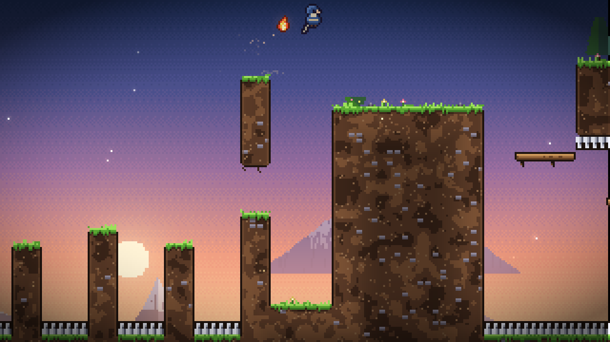
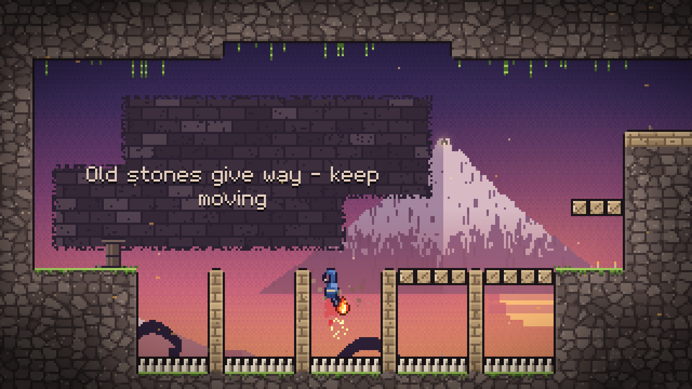
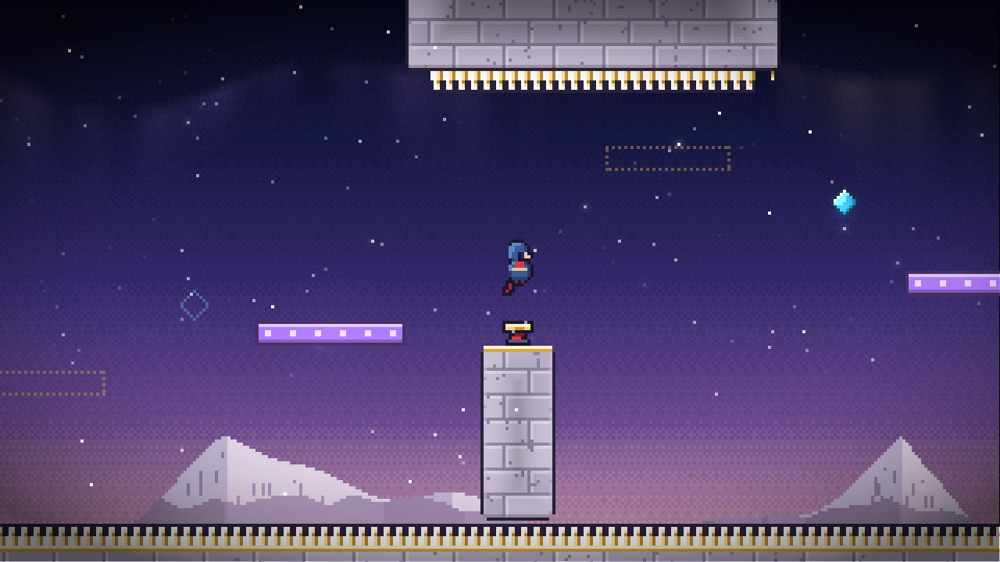

# HOLY PEAK

*A pilgrimage in four chapters.*

They say a bell hangs at the top of the Holy Peak, silent for a thousand years, and that whoever rings it will be heard by the sky itself.
You have walked a long way to find out.

**Holy Peak** is a precision platformer about climbing a sacred mountain. Run, jump, slide down walls, kick off them, and later dash through the air in any of eight directions.
The climb crosses four handcrafted chapters, and twelve hidden embers wait for anyone willing to take the harder path.


| | |
|---|---|
|  |  |
|  |  |

## The climb

| Chapter | | New idea |
|---|---|---|
| I | **The Foothills** | running, variable-height jumps, one-way ledges, wall jumps, spikes |
| II | **The Forgotten Ruins** | the *Wind's Gift* (the dash), crumbling stones |
| III | **Frostwind Cliffs** | springs and wall springs, dash crystals, wind and gusts |
| IV | **The Holy Peak** | golden pulse stones that appear and vanish to the mountain's heartbeat |

There are 24 rooms and 12 embers. Your scarf shows your dash: **red** means it is ready, **blue** means it is spent.
Touching the ground, a spring or a crystal gives the dash back.

## Controls

| Action | Keyboard | Gamepad |
|---|---|---|
| Move / aim | Arrow keys or WASD | Left stick / D-pad |
| Jump | C, Space or J | A |
| Dash | X, Shift or K | X, B, RB or RT |
| Pause | Esc or Enter | Start |
| Restart room | R | Back |
| Fullscreen | F11 | |

Hold jump to jump higher, and tap it for a short hop. To wall jump, jump while sliding against a wall.
Button prompts switch automatically between keyboard and gamepad.

## Features

- Tight, forgiving movement: coyote time, jump and dash buffering, corner correction, variable jump height, wall jumps, an eight-way dash, and super and hyper jumps for players who look for them.
- Everything is generated in code. There is no asset folder. The pixel font, sprites, terrain tiles, parallax mountains, particles, every sound effect and all six music tracks are synthesized at startup.
- Every chapter has its own look: a dawn forest, sunset ruins, moonlit ice and a golden night above the clouds. The Holy Peak on the horizon grows closer as you climb.
- An original soundtrack shares one recurring theme: minor on the title screen, Lydian at the summit and resolved in major for the ending.
- Chapter cards, a prologue, a cutscene when you receive the dash, a bell that you actually ring, an epilogue, statistics and credits.
- Progress saves automatically: room, deaths, time and embers. Chapter Select lets you revisit chapters you have reached to hunt for embers.
- Options cover music and sound volume, fullscreen, window size, screen shake and a speedrun timer.
- An assist mode offers game speed from 50 to 100%, infinite dash and invincibility.
- Every room is proven beatable. A built-in solver searches the real game physics, and the game has been played start to finish with the solver's inputs.

## Download

Ready-to-play builds for Windows, macOS (Apple Silicon and Intel) and Linux are on the [Releases page](../../releases).
Nothing needs installing: unzip and play. Each download includes a `README.txt` with first-launch notes for unsigned apps.

## Running from source

You need the [.NET 8 SDK](https://dotnet.microsoft.com/download).

```sh
dotnet run --project src/HolyPeak -c Release
```

On the first launch the soundtrack renders in the background, which takes a few seconds, and is then cached.
Saves and settings live in a `HolyPeak` folder inside your user application-data folder (for example `%APPDATA%\HolyPeak` on Windows or `~/.config/HolyPeak` on Linux).
Set `HOLYPEAK_DATA` to use a different folder.

### Building release packages

```sh
build/package.sh 1.0.0                      # all platforms, written to dist/
build/package.sh 1.0.0 win-x64 linux-x64    # or just some
```

This produces a Windows zip, a Linux tarball and macOS `.app` bundles. The `.app` bundles are ad-hoc signed when built on a Mac, which Apple Silicon requires.
The [Release workflow](.github/workflows/release.yml) runs the same script on GitHub Actions and publishes the result. Start it from the Actions tab, or push a `v*` tag.

MonoGame's DesktopGL runtime bundles SDL2 and OpenAL, so nothing else needs installing.
If the machine has no audio device, the game runs silently instead of failing.

## For developers

```
src/HolyPeak/
  World/      the simulation: player physics, rooms, entities, level loading (no graphics)
  World/levels.txt   all 24 rooms as ASCII maps
  Gfx/        procedural art: tiles, backdrops, sprites, particles, player visuals
  Audio/      synthesizer, sound effects, the score and its renderer, playback
  Scenes/     title, gameplay, ending, menus
tools/HolyPeak.Verify/   level solver and verifier
```

### Level format

Rooms live in `src/HolyPeak/World/levels.txt` and play in file order. Each map is at least 40x23 tiles of 8 px.

```
#  terrain        =  secondary terrain   :  background wall   -  one-way platform
^ v < >  spikes   C  crumbling block      S  spring            { }  wall springs
D  dash crystal   E  ember                1 2  pulse blocks     P  player spawn
G  shrine (dash)  B  summit bell          h k  hint text anchors
```

Each room also sets `exit: top|left|right|none`, and can set `hint:` and `hint2:` text, `wind: <px/s> [period]` and `pulse: <seconds>`.

### Proving the rooms

```sh
dotnet run --project tools/HolyPeak.Verify -c Release              # every room and every ember
dotnet run --project tools/HolyPeak.Verify -c Release -- --k 8     # inputs may only change every 8 frames
dotnet run --project tools/HolyPeak.Verify -c Release -- --room 3- --ascii --replays out/
```

The verifier runs a best-first search over the real simulation, so a solution it finds is an exact input sequence, not an approximation.
Every room and ember is solvable even when inputs can only change every 133 ms, which suggests no room needs frame-perfect play.

### Automation

The game binary has flags for screenshots and end-to-end checks:

```sh
HolyPeak --scene game --room 2-3 --replay out/2-3.txt --frames 120 --shot shot.png
HolyPeak --scene game --room 1-1 --replay-all out/ --embers --frames 12000   # plays the whole game
HolyPeak --scene title --keys "80:Down,95:Confirm" --frames 200 --shot menu.png
HolyPeak --render-audio wav/                                                 # every sound and song as WAV
```

## Credits

Design, code, pixel art, music and sound by Claude. Built with [MonoGame](https://monogame.net).
